 

## `whoami` — A little about me

I'm **Sreehari S**, a final-year B.Tech Computer Science & Engineering
student specializing in Artificial Intelligence and Machine Learning at
the College of Engineering Attingal.

I enjoy moving between machine learning experiments, practical software
development, and creative projects. I like understanding how things
work, building prototypes, and turning ideas into useful products.

- 🛰️ **North star:** Aspiring ISRO engineer
- 🤖 **Main interests:** AI/ML, computer vision, intelligent
  applications
- 💻 **Also building with:** Python, web technologies, databases and
  APIs
- 🎤 **Community:** Student leadership, technical sessions and
  hackathons
- 🎧 **Off-screen:** Music production, mixing and mastering
- 🤝 **Open to:** Meaningful collaborations, ideas and learning
  opportunities

> *Curiosity is the input. Building is the output.*

## ✨ Highlights

  
  

## 🧭 Experience & community

**Professional experience**

- **Frontend & Testing Intern — Logixmotion**  
  Working with frontend development, testing and practical software
  workflows.

**Leadership & student communities**

| Community        | Role                                 |
|:-----------------|:-------------------------------------|
| IEEE RAS CEAL    | Secretary                            |
| IEDC CEAL        | PR & Social Media Lead               |
| FOSS CEAL        | Deputy Chief Financial Administrator |
| TinkerHub CEAL   | Learning Coordinator                 |
| ISTE CEAL        | Tech Lead                            |
| Layam Music Club | Treasurer                            |
| Hack404          | Founder / Community Lead             |

**Selected speaking engagements**

- *ML IN MOTION: From Data to Deployment* — INFORMATYKA 6.0
- *Into the World of Machines: From Classical ML to Deep Learning* —
  TechX REIGNITE

## 🚀 Things I've built

A few projects from my AI/ML, computer vision and
application-development journey.

### 🖐️ SigNet — Hand Sign Recognition

A computer-vision project that detects and classifies hand signs,
exploring accessible human-computer interaction.  
`Python` `MediaPipe` `OpenCV` `Albumentations` `Random Forest`

### 🏥 Health Vigilance Hub

A predictive outbreak-monitoring concept combining time-series
forecasting with geographical visualization.  
`Python` `Prophet` `Folium` `Machine Learning`

### 🚨 Kavach — Emergency Reporting

An emergency-reporting application concept for submitting incidents and
managing emergency information.  
`Flask` `Python` `MySQL`

### 🏠 PAVI - Personal Automated Virtual Intelligence

A web dashboard concept for viewing and managing smart-home
information.  
`Flask` `Python` `MySQL`

### 🌌 JWST Multimedia App

An educational multimedia application inspired by the James Webb Space
Telescope, featuring interactive learning and quizzes.  
`Python` `Tkinter` `Pygame`

  

## 🧰 Tech constellation

  <strong>LANGUAGES</strong> 
  

  <strong>FRAMEWORKS & DEVELOPMENT</strong> 
  

  <strong>AI / ML & DATA</strong> 
  
   
  
  
  

  <strong>DATABASES & TOOLS</strong> 
  

## 📊 GitHub telemetry

## 🔥 Contribution Streak

## 🎧 Beyond the terminal

Music is my other creative playground. I enjoy producing music,
experimenting with sound, and working on mixing and mastering. It gives
me a different way to think about patterns, detail and creativity.

`Music production` `Sound design` `Mixing` `Mastering`

## 📡 Find me around the internet

  

**Thanks for stopping by. Keep learning, keep building, keep creating.**
✨

